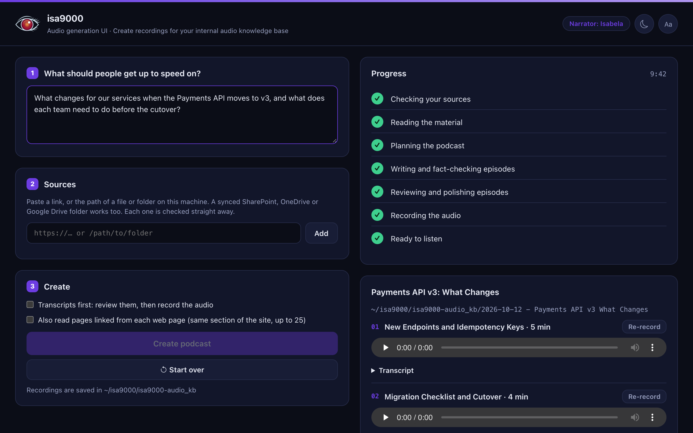

# Audio generation UI

The audio generation UI is the browser app for creating recordings. It runs the same steps as
the command line and shows them in plain language.

```bash
isa9000 audio-generation-ui [--port 8790] [--no-browser]
```

Run it from the folder that holds `isa9000.toml`, or pass `--config` before
`audio-generation-ui`. It answers only on `127.0.0.1`. Its browser tab shows the run's status, for
example *● Recording the audio · Audio generation UI*, and its icon carries a red record
badge, so it is easy to tell apart from the presentation website.

<p align="center">
  
</p>

## Create a podcast

1. **Ask:** describe what people should get up to speed on. The request steers
   the plan; the sources decide the facts.
2. **Sources:** add links, files or folders, including synced SharePoint,
   OneDrive or Google Drive folders. Each one is checked as you add it.
   *Access refused* means it needs a sign-in: use a synced folder or an
   exported copy.
3. **Create:** tick *Transcripts first* to review before recording, or *Also
   read pages linked from each web page* to read up to 25 more pages from the
   same section of a site.

The progress card follows the run: checking, reading, planning, writing and
fact-checking, reviewing and polishing, recording, ready.

| Button | What it does |
|---|---|
| **Stop** | Ends the run at once. |
| **Retry** | Runs a stopped or failed run again. A written podcast only records its missing episodes. |
| **Start over** | Clears the request, sources and results. Finished podcasts stay on disk. |
| **Transcript** | Shows the episode's transcript under it, to read before you record. |
| **Record audio** | Records the episodes that have no audio: after *Transcripts first*, or after a review. |
| **Re-record** | Records one episode again, for example after you corrected its transcript. |
| **Download all** | Saves the podcast as a ZIP: MP3s, transcripts, cover and `podcast.json`. |

A podcast below the [quality bar](quality.md#the-quality-gate) is not recorded:
the progress card says **Needs review** and why. Claims the fact-check could not
confirm, and recordings worth a listen, are shown under their episode.

## Presentation website

**Build the presentation website** builds it on this computer from every
recorded podcast. Nothing is uploaded. **Open it** to listen and check,
then **Download it** as a ZIP and upload the files to your company's web server
or storage. Build it again after every change; see
[Presentation website and publishing](publishing.md).

The sun and moon button switches light and dark; **Aa** switches to a
dyslexia-friendly font.
