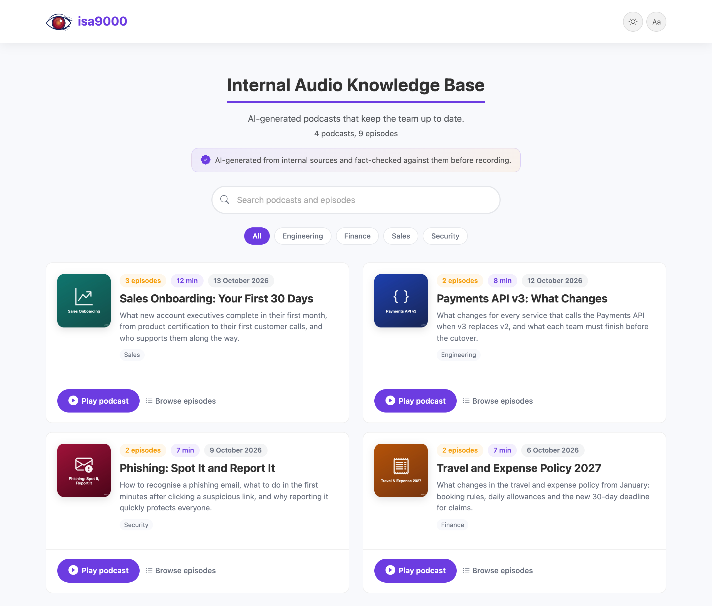

<p align="center">
  <picture>
    <source media="(prefers-color-scheme: dark)" srcset="assets/img/isa9000-hero-dark.png">
    
  </picture>
</p>

isa9000 turns your organization's documents and links into short, fact-checked
podcasts and publishes them as a private audio knowledge base, inside your own
network and with your own branding. It follows the production rules of
[Dev Stories](https://devstories.eu) and runs on Microsoft Azure (Microsoft
Foundry) by default, or on Google Cloud (the Gemini API or Vertex AI).

<p align="center">
  
</p>

## Quick start

**Now meet [isa9000-ops](https://github.com/AlexandruGirlea/isa9000-ops): your
business can run the engine behind Dev Stories as its own audio learning space.**
Add your name and logo, let employees sign in with Microsoft, and give each team
a library of podcasts made from your documents. IT runs the application in your
Azure environment; employees create and listen in the browser.

[See the installation journey](https://alexandrugirlea.github.io/isa9000-ops/getting-started.html){: .btn .btn-primary }

Azure deployment is validated; general company-domain production setup remains
pending. For individual use, start below.

```bash
pip install "isa9000[audio-generation-ui]"
isa9000 init                           # writes isa9000.toml: add your Azure or Google credentials
isa9000 audio-generation-ui            # create podcasts in your browser at http://127.0.0.1:8790
isa9000 presentation-website --serve   # build the presentation website, preview it at http://127.0.0.1:8800
```

Python 3.11 or newer, on Linux or macOS. No ffmpeg or other system tools.
Servers and CI only need `pip install isa9000`. For Microsoft Foundry on Azure,
see [Configuration](configuration.md#azure); for the Gemini API, Vertex AI and
service accounts, see [Configuration](configuration.md#google).

## Ways to use it

| Who | How | Publishing |
|---|---|---|
| Business users | The [audio generation UI](audio-generation-ui.md), on their own computer | Download the presentation website as a ZIP and upload it |
| Developers | The [command line or Python](cli.md), in scripts and schedules | Their own upload step, for example to Azure Blob Storage |
| Everyone, on a company portal | The podcasts folder in Git, published by CI | [GitHub Actions](publishing.md#automate-with-github-actions) |
| Teams with Microsoft work accounts | [isa9000-ops](https://alexandrugirlea.github.io/isa9000-ops/) in the browser | Your organization's Azure installation and group libraries |

The audio generation UI serves one person on one computer: it answers only on
`127.0.0.1` and has no sign-in. isa9000-ops provides the separate shared application
with Microsoft sign-in and group access.

## What leaves your machine

Only what the models need: your request, the content of your sources (PDFs
are sent as files), the scripts to record and short clips of each recording for
its check. It goes to the model endpoints you configure: the Gemini API
with your key, Vertex AI in your own project, or Microsoft Foundry. The
presentation website is static files with no server code, analytics or tracking.

Developed by [Isabela](https://isabela.girlea.ro) and Alex @
[girlea.ro](https://girlea.ro). Apache-2.0.
