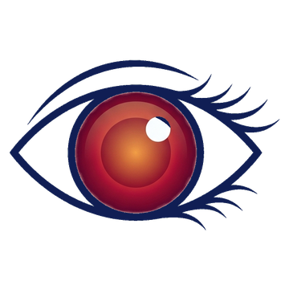
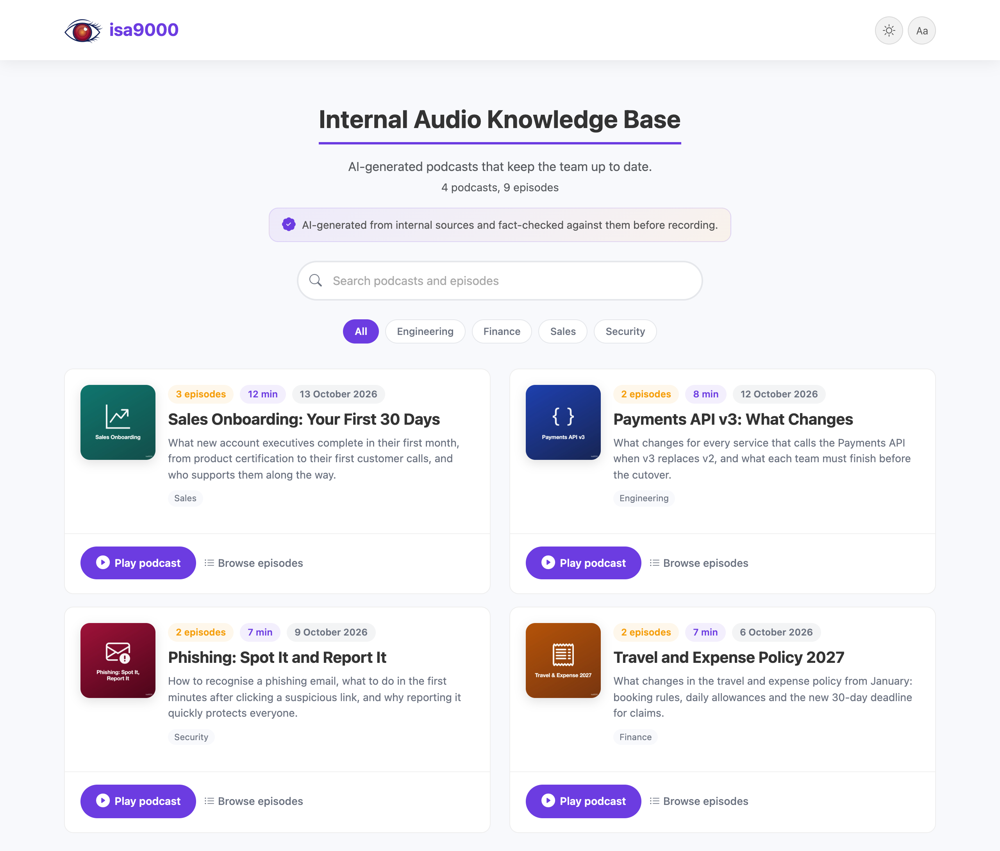

<p align="center">
  <picture>
    <source media="(prefers-color-scheme: dark)" srcset="assets/img/isa9000-hero-dark.png">
    
  </picture>
</p>

isa9000 turns your organization's documents and links into short, fact-checked
podcasts and publishes them as a private audio knowledge base, inside your own
network and with your own branding. It follows the production rules of
[Dev Stories](https://devstories.eu).

<p align="center">
  
</p>

## Quick start

```bash
pip install "isa9000[audio-generation-ui]"
isa9000 init                           # writes isa9000.toml: add a Gemini API key to it
isa9000 audio-generation-ui            # create podcasts in your browser at http://127.0.0.1:8790
isa9000 presentation-website --serve   # build the presentation website, preview it at http://127.0.0.1:8800
```

Python 3.11 or newer, on Linux or macOS. No ffmpeg or other system tools.
Servers and CI only need `pip install isa9000`. For Vertex AI and service
accounts, see [Configuration](configuration.md#google).

## Ways to use it

| Who | How | Publishing |
|---|---|---|
| Business users | The [audio generation UI](audio-generation-ui.md), on their own computer | Download the presentation website as a ZIP and upload it |
| Developers | The [command line or Python](cli.md), in scripts and schedules | Their own upload step, for example to Azure Blob Storage |
| Everyone, on a company portal | The podcasts folder in Git, published by CI | [GitHub Actions](publishing.md#automate-with-github-actions) |

The audio generation UI serves one person on one computer: it answers only on
`127.0.0.1` and has no sign-in. A shared audio generation UI hosted on a portal
is planned.

## What leaves your machine

Only what the models need: your request, the content of your sources (PDFs
are sent as files), the scripts to record and short clips of each recording for
its check. It goes to the Google model endpoints you configure: the Gemini API
with your key, or Vertex AI in your own project. The
presentation website is static files with no server code, analytics or tracking.

Developed by [Isabela](https://isabela.girlea.ro) and Alex @
[girlea.ro](https://girlea.ro). Apache-2.0.
