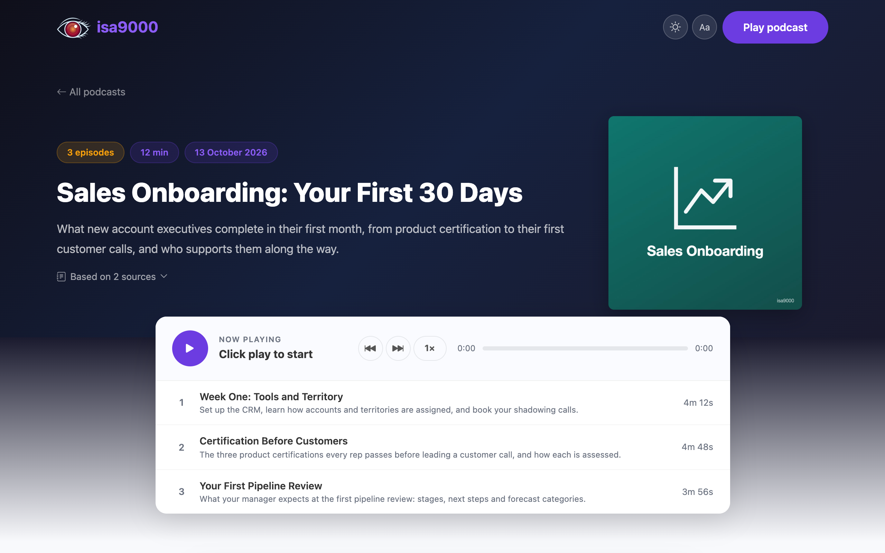

# Presentation website and publishing

`isa9000 presentation-website` builds the presentation website from the podcasts
folder into `isa9000-presentation_website/`. `--serve` previews it at
`http://127.0.0.1:8800`; in the audio generation UI,
**Build the presentation website** does the same. It needs no model credentials and
never calls a model.

<p align="center">
  
</p>

Listeners get search across podcasts and episodes, cover art, a player with
speed control and a mini player, transcripts, download and share links, light
and dark mode, a dyslexia-friendly font, and an icon for their phone's home
screen. Add `"tags": ["Security", "HR"]` to a `podcast.json` for a topic filter.
The site is static files with no server code or tracking, and asks search
engines not to index it.

## After every change

The presentation website does not update itself. After a new podcast, a re-recorded episode,
a corrected transcript, a new cover or a removed podcast folder, build it again
and upload it:

```bash
isa9000 record "isa9000-audio_kb/<podcast>" --episode 2   # if an episode changed
isa9000 presentation-website
az storage blob sync --account-name <account> --container '$web' --source isa9000-presentation_website --auth-mode login --delete-destination true
```

Other hosts:

```bash
aws s3 sync isa9000-presentation_website s3://intranet-audio-kb --delete
gcloud storage rsync isa9000-presentation_website gs://intranet-audio-kb --recursive --delete-unmatched-destination-objects
rsync -a --delete isa9000-presentation_website/ webserver:/var/www/audio-kb/
```

Serve it only inside your network. The host must answer byte-range requests so
the player can seek; all of the above do, Python's `http.server` does not. Set
`[presentation_website] base_url` to also get podcast feeds people can subscribe to.

## Automate with GitHub Actions

Keep the podcasts folder in a private repository and let CI publish every
change, from a new podcast to a single re-recorded episode. Set the repository
up once:

```bash
git lfs install
git lfs track "*.mp3" "*.jpg" "*.png"
rm isa9000-audio_kb/.gitignore      # isa9000 adds it to prevent accidental commits
git add .gitattributes isa9000-audio_kb isa9000.toml   # commit the config without keys
git commit -m "Add the audio knowledge base"
```

`.github/workflows/publish-website.yml` rebuilds and uploads the presentation website
whenever anything in the podcasts folder changes. The Azure identity needs the
*Storage Blob Data Contributor* role.

```yaml
name: Publish the audio knowledge base
on:
  push:
    branches: [main]
    paths: ["isa9000-audio_kb/**", "isa9000.toml"]
  workflow_dispatch:
permissions:
  contents: read
  id-token: write
jobs:
  publish:
    runs-on: ubuntu-latest
    steps:
      - uses: actions/checkout@v4
        with:
          lfs: true
      - uses: actions/setup-python@v5
        with:
          python-version: "3.13"
      - run: pip install isa9000
      - run: isa9000 presentation-website
      - uses: azure/login@v2
        with:
          client-id: ${{ secrets.AZURE_CLIENT_ID }}
          tenant-id: ${{ secrets.AZURE_TENANT_ID }}
          subscription-id: ${{ secrets.AZURE_SUBSCRIPTION_ID }}
      - run: >-
          az storage blob sync --account-name ${{ vars.AZURE_STORAGE_ACCOUNT }}
          --container '$web' --source isa9000-presentation_website --auth-mode login --delete-destination true
```

`.github/workflows/create-podcast.yml` creates a podcast from the **Actions**
tab and opens a pull request, so someone reviews it before it is published.
Add the `AZURE_OPENAI_API_KEY` secret and the `AZURE_OPENAI_ENDPOINT` variable.
On Google, commit an `isa9000.toml` with `provider = "google"` and pass a
`GEMINI_API_KEY` secret instead.

```yaml
name: Create a podcast
on:
  workflow_dispatch:
    inputs:
      request:
        description: What should people get up to speed on?
        required: true
      sources:
        description: Links, separated by spaces
        required: true
permissions:
  contents: write
  pull-requests: write
jobs:
  create:
    runs-on: ubuntu-latest
    steps:
      - uses: actions/checkout@v4
        with:
          lfs: true
      - uses: actions/setup-python@v5
        with:
          python-version: "3.13"
      - run: pip install isa9000
      - name: Create the podcast
        env:
          AZURE_OPENAI_ENDPOINT: ${{ vars.AZURE_OPENAI_ENDPOINT }}
          AZURE_OPENAI_API_KEY: ${{ secrets.AZURE_OPENAI_API_KEY }}
          REQUEST: ${{ inputs.request }}
          SOURCES: ${{ inputs.sources }}
        run: |
          args=()
          for source in $SOURCES; do args+=(-s "$source"); done
          isa9000 create -r "$REQUEST" "${args[@]}" || [ $? -eq 3 ]
      - name: Open a pull request
        env:
          GH_TOKEN: ${{ github.token }}
          REQUEST: ${{ inputs.request }}
        run: |
          git config user.name "github-actions[bot]"
          git config user.email "41898282+github-actions[bot]@users.noreply.github.com"
          git switch -c "podcast/${{ github.run_id }}"
          git add isa9000-audio_kb
          git commit -m "Add podcast: $REQUEST"
          git push origin HEAD
          gh pr create --title "New podcast: $REQUEST" --body "Read the transcripts and listen before merging. Without MP3s, it needs review: see podcast.json."
```

A podcast that needs review arrives without audio. After the review, record it
on the same branch with `isa9000 record` and push the MP3s; merging then
publishes it.
